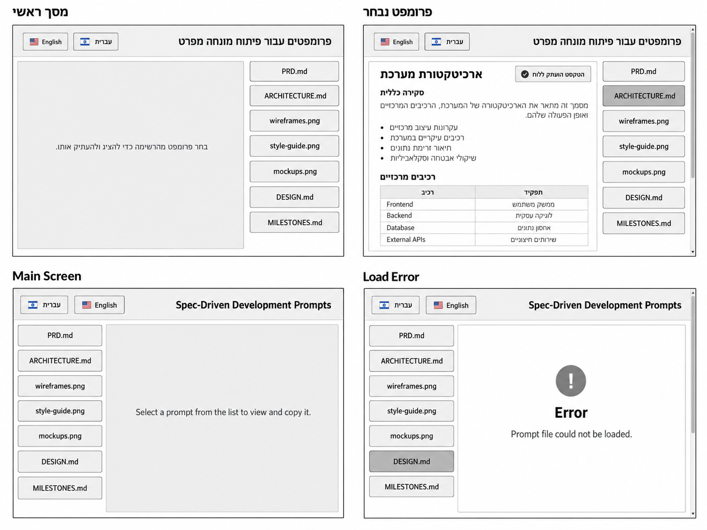
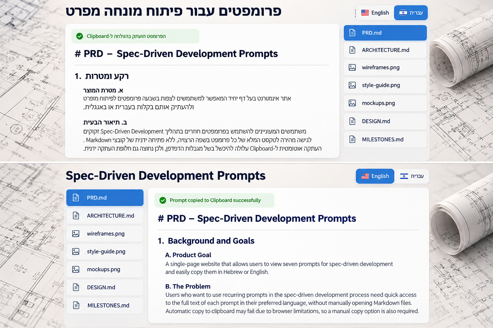
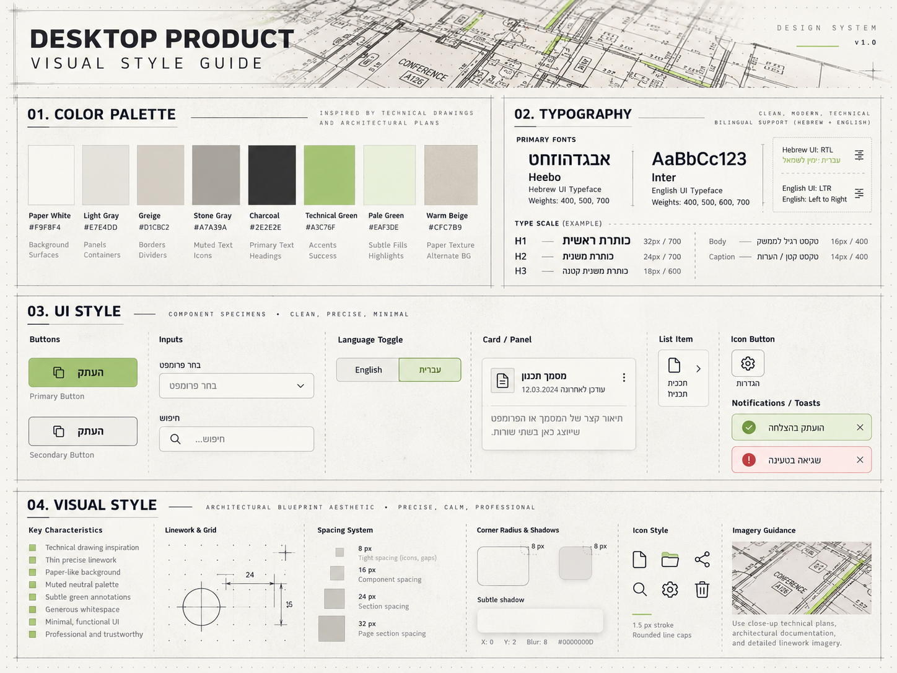

# DESIGN – Spec-Driven Development Prompter

מסמך זה מתאר את מימוש הממשק החזותי של האתר, בהתבסס על ה-PRD, ה-Wireframes, ה-Style Guide וה-Mockups. ה-PRD הוא המקור המחייב להתנהגות המוצר; ה-Wireframes מגדירים את מבנה הממשק; ה-Style Guide מגדיר את השפה החזותית; וה-Mockups ממחישים את המראה המעוצב. אין במסמך זה הגדרה של מסכים או יכולות חדשים.

## 1. Screens – מסכי האפליקציה

האתר כולל **דף יחיד בלבד**. ארבע הדוגמאות ב-Wireframes מתארות **מצבי תצוגה של אותו דף**, ולא ארבעה דפים נפרדים. ה-Mockups ממחישים בעיקר את מצב הפרומפט הנבחר בשתי השפות.

### Wireframes

### Mockups

### 1.1 מסך ראשי – מצב התחלתי בעברית

- **מטרה:** לאפשר בחירת פרומפט להצגה ולהעתקה.
- **מבנה ותוכן:** בראש הדף הכותרת **„פרומפטר לפיתוח מונחה מפרט”** ושני לחצני השפה **🇮🇱 „עברית”** ו-**🇺🇸 „English”**. מתחתיהם שני אזורים זה לצד זה: טור של שבעה לחצני פרומפטים **מימין**, ואזור תוכן גדול, תחום וקריא **משמאל**. באזור התוכן מופיעה ההנחיה **„בחר פרומפט מהרשימה כדי להציג ולהעתיק אותו.”**
- **פעולות וניווט:** לחיצה על פרומפט מציגה אותו באותו דף ומנסה להעתיק את מקור ה-Markdown. לחיצה על **English** משנה את שפת וכיוון הממשק ומחזירה אותו למצב בחירה ריק.

### 1.2 פרומפט נבחר – מצב תצוגת תוכן

- **מטרה:** קריאת הפרומפט שנבחר והעתקת ה-Markdown המקורי.
- **מבנה ותוכן:** הכותרת, בחירת השפה וטור שבעת הלחצנים נשארים במקומם. הלחצן שנבחר מודגש חזותית, ואזור התוכן מציג את הקובץ כ-**Rendered Markdown**, כולל היררכיית כותרות, פסקאות, רשימות וטבלאות בהתאם למקור. הודעת משוב קצרה על תוצאת ניסיון ההעתקה מוצגת כ-**Toast קופץ** בתחתית הדף, מתחת לטור לחצני הפרומפטים, ואינה חלק מאזור התוכן (ראו 2.3). ה-Wireframes מדגימים תוכן ארוך, וה-Mockups מדגימים את סגנון התצוגה המעוצב.
- **פעולות וניווט:** לחיצה על לחצן אחר מחליפה את התוכן ומחזירה את הגלילה **שבתוך אזור התוכן** לתחילת הפרומפט החדש. בתחתית הפרומפט מופיע קישור שמציג ומסתיר את מקור ה-Markdown (ראו 2.3); כשהמקור מוצג ניתן לסמן ולהעתיק אותו ידנית, גם כשמדובר בקטע חלקי. ניסיון העתקה אוטומטית שנכשל אינו מונע הצגת התוכן.
- **דגש למימוש:** עיצוב אזור הקריאה כ-Markdown מרונדר אינו פוטר מדרישת העתקת טקסט המקור עם סימוני ה-Markdown. יש לממש את ההתנהגות בהתאם ל-PRD ולארכיטקטורה, בלי להוסיף רכיב ממשק שלא הוגדר במקורות. גובה אזור התוכן זהה לגובה טור הלחצנים; תוכן ארוך נגלל אנכית בתוכו (ראו 2.4, Scrolling).

### 1.3 Main Screen – מצב התחלתי באנגלית

- **מטרה:** אותה בחירה ראשונית, בממשק באנגלית.
- **מבנה ותוכן:** הכותרת **“Spec-Driven Development Prompter”**. כיווניות **LTR**, טור לחצני הפרומפטים **משמאל** ואזור התוכן **מימין**. ההנחיה: **“Select a prompt from the list to view and copy it.”** שני לחצני השפה שומרים על הכיתוב הקבוע שלהם ועל הסדר ביניהם („עברית” מימין ל-„English”, ראו 2.3), ושמות הפרומפטים אינם מתורגמים.
- **פעולות וניווט:** בחירת פרומפט מציגה ומעתיקה את הקובץ המקביל באנגלית. מעבר ל-**עברית** מנקה את הבחירה ומחזיר את תצוגת ההנחיה בעברית.

### 1.4 Load Error – מצב כשל בטעינת פרומפט

- **מטרה:** להודיע שקובץ הפרומפט המבוקש לא נטען, ולאפשר בחירה מחדש.
- **מבנה ותוכן:** מסגרת הדף, לחצני השפה וטור הפרומפטים אינם משתנים. במקום תוכן ישן מוצגת הודעת שגיאה באזור התצוגה, בשפת הממשק הפעילה. ב-Wireframe האנגלי מופיעים כותרת שגיאה וסמל התראה בצבע ניטרלי.
- **פעולות וניווט:** שבעת לחצני הפרומפטים נשארים זמינים כדי לנסות פרומפט אחר. החלפת שפה מחזירה את אזור התצוגה למצב ההנחיה.

### Navigation – מבנה הניווט הכללי

אין מעבר בין דפים ואין תפריט ניווט לאזורים נוספים. כל הפעולות מתבצעות **באותו דף**: בחירת שפה, בחירת פרומפט, קריאה והעתקה. סדר שבעת הלחצנים קבוע בשתי השפות:

1. `PRD.md`
2. `ARCHITECTURE.md`
3. `wireframes.png`
4. `style-guide.png`
5. `mockups.png`
6. `DESIGN.md`
7. `MILESTONES.md`

שמות אלה הם **תוויות לחצנים**; תוכן הפרומפטים נטען מקובצי Markdown תואמים. בחירת שפה מעבירה לפריסה תמונת-ראי ושומרת על אותם רכיבים. טור הבחירה נשאר גלוי במקומו, ובתוכן ארוך הגלילה היא בתוך אזור התוכן בלבד.

## 2. Style Guide – השפה העיצובית

### Style Guide Reference

### 2.1 Color Palette

השפה העיצובית בהשראת **שרטוטים אדריכליים ותוכניות בנייה**: גווני נייר ואפור חמים, טקסט כהה וירוק טכני כמבטא. הצבעים המוגדרים ב-Style Guide:

| Color Token | HEX | שימוש מרכזי |
|---|---|---|
| Paper White | `#F9F8F4` | רקע הדף ומשטחים בהירים |
| Light Gray | `#E7E4DD` | משטחי Panels ו-Containers |
| Greige | `#D1CBC2` | גבולות ומפרידים |
| Stone Gray | `#A7A39A` | מידע משני ואייקונים מאופקים |
| Charcoal | `#2E2E2E` | טקסט ראשי וכותרות |
| Technical Green | `#A3C76F` | הדגשת בחירה, Accent ואישורי הצלחה |
| Pale Green | `#EAF3DE` | רקע עדין להדגשה ולהודעות הצלחה |
| Warm Beige | `#CFC7B9` | טקסטורה ורקע חלופי |

**הבהרת עקביות:** ב-Mockups מופיע גם כחול רווי בלחצנים נבחרים ובכותרות, אך אין לו Color Token או HEX מוגדר ב-Style Guide. כדי לשמור על שפה עיצובית חד-משמעית יש להעדיף את פלטת הצבעים המוגדרת לעיל, ובפרט את **Technical Green** להדגשות, במקום להמציא קוד צבע כחול. גם השימוש בתוכניות האדריכליות יהיה מרוסן כדי לשמור על קריאות.

### 2.2 Typography

| תפקיד | Font | Size | Weight |
|---|---|---|---|
| H1 – כותרת ראשית | Heebo בעברית / Inter באנגלית | `32px` | `700` |
| H2 – כותרת משנה | Heebo / Inter | `24px` | `700` |
| H3 – כותרת קטנה | Heebo / Inter | `18px` | `600` |
| Body – טקסט רגיל | Heebo / Inter | `16px` | `400` |
| Caption – הערות וטקסט משני | Heebo / Inter | `14px` | `400` |

- משקלי הגופנים הזמינים המוצגים ב-Style Guide: `400`, `500`, `600`, `700`.
- טיפוגרפיה נקייה, מודרנית וקריאה; כותרות ברורות מעל תוכן Markdown צפוף יחסית.
- בבלוקי Markdown נשמרת היררכיה חזותית באמצעות גדלים, משקל ומרווחים בין כותרות, פסקאות, רשימות וטבלאות.
- בעברית כיווניות ויישור לימין; באנגלית כיווניות ויישור לשמאל. שמות קבצים ומונחים באנגלית נשמרים קריאים גם בתוך ממשק RTL.

### 2.3 UI Style

- **Language Toggle:** שני לחצנים סמוכים וגלויים, עם דגל וכיתוב קבוע. הבחירה הפעילה מודגשת במילוי/מסגרת עדינים מפלטת ה-Accent. אין לשנות את שמות השפות. **סדר הלחצנים קבוע בשתי השפות: „עברית” תמיד מימין ל-„English”** – גם בממשק האנגלי, בשונה מהמצויר ב-Wireframes. מיקום צמד הלחצנים על הדף ממשיך להתהפך עם כיוון הממשק.
- **Prompt Buttons:** שבעה לחצנים אנכיים, אחידים ברוחבם, עם מסגרת דקה, פינות מעוגלות מעט ומרווחים קבועים. הלחצן הנבחר בולט יותר מהאחרים; שמות הקבצים נשארים כפי שהם בשתי השפות.
- **Content Panel:** משטח בהיר עם מסגרת ברורה, פינות מעוגלות קלות וצל עדין. מציג הנחיה, Markdown מרונדר או שגיאה לפי מצב התצוגה. **גובהו זהה בדיוק לגובה טור לחצני הפרומפטים**, והוא מיושר אליו למעלה ולמטה; תוכן ארוך נגלל בתוכו אנכית בלבד, בלי גלילה אופקית.
- **Markdown Source Toggle:** בתחתית הפרומפט המוצג, מתחת לקו מפריד דק, מופיע קישור טקסט בשפת הממשק – „מקור Markdown להעתקה ידנית” / “Markdown source for manual copy” – בגודל Caption, משקל `600`, עם קו תחתון ב-Technical Green. המקור **מוסתר כברירת מחדל**; לחיצה על הקישור מציגה מתחתיו את טקסט ה-Markdown המקורי בתיבה לקריאה בלבד (גופן Monospace, רקע Paper White, מסגרת Greige, `8px` Corner Radius), ולחיצה נוספת מסתירה אותה. התיבה גדלה לגובה התוכן שלה ונגללת יחד עם אזור התוכן, בלי גלילה משלה. בחירת פרומפט אחר או החלפת שפה מחזירות אותה למצב מוסתר.
- **Feedback (Toast):** תוצאת ניסיון ההעתקה מוצגת כהודעת **Toast קופצת**, ולא בתוך אזור התוכן.
  - **מיקום:** מוצמדת לתחתית חלון הדפדפן, בצד של טור לחצני הפרומפטים ומיושרת אליו – בעברית בתחתית מימין, באנגלית בתחתית משמאל. מאחר שאזור התוכן מסתיים בגובה טור הלחצנים, ההודעה מופיעה מתחתיו ואינה מכסה את טקסט הפרומפט.
  - **מידות:** רוחב ההודעה **מותאם לטקסט שלה** – ההודעה מוצגת בשורה אחת, ברוחב הנדרש לה. רק אם חלון הדפדפן צר מההודעה, הטקסט נשבר לשורות וגובה ההודעה גדל, כך שהיא לעולם אינה חורגת מרוחב העמוד.
  - **התנהגות:** מופיעה באנימציית קפיצה קצרה מלמטה, נשארת מוצגת ונעלמת מעצמה: הודעת הצלחה לאחר **3 שניות**, הודעת כישלון לאחר **5 שניות** (היא ארוכה יותר וכוללת הנחיה להעתקה ידנית). ניסיון העתקה חדש מחליף את ההודעה הקודמת ומתחיל את הספירה מחדש. אין לחצן סגירה.
  - **עיצוב:** אייקון קווי וטקסט בגודל Caption, מסגרת דקה, `8px` Corner Radius וצל מודגש מעט מזה של ה-Panels כדי להבליט אותה מעל הדף. הצלחה: רקע Pale Green ומסגרת Technical Green, עם אייקון אישור. כישלון: רקע Light Gray ומסגרת Charcoal, עם אייקון התראה – בלי צבע אדום, שאין לו Color Token.
  - אין להסתמך על צבע בלבד להעברת משמעות ההודעה. נוסח ההודעה יתאים לשפה ולתוצאה בפועל.
- **Icons:** אייקונים קוויים פשוטים עבור קבצים, העתקה, הצלחה ושגיאה, במקומות שבהם הם כבר מופיעים בדוגמאות. קו אחיד ודק יחסית; להימנע מקישוטים או מפעולות חדשות שאינן ב-PRD.
- **Inputs / Search / Settings:** אף שה-Style Guide מציג דוגמאות כלליות לרכיבים אלה, הם **אינם חלק מממשק המוצר** לפי ה-PRD ולכן אין לשלבם באתר.

### 2.4 Visual Style, Spacing & Layout

- **אופי חזותי:** מקצועי, רגוע, מדויק ומינימליסטי, בהשראת נייר תוכניות, גרידים וקווי שרטוט עדינים.
- **Surfaces:** משטחים בהירים עם ניגודיות טקסט גבוהה. הלחצנים ואזור התוכן הם משטחים אטומים מעל תמונת הרקע, כך שהתמונה אינה מופיעה מאחורי פסקאות קריאה.
- **Page Background:** תמונת רקע של שרטוטים אדריכליים וגלילי תוכניות בגוונים בהירים-כחלחלים (`src/assets/background.webp`). התמונה **ממלאת תמיד את כל חלון הדפדפן**, בכל גודל חלון: היא מוגדלת או מוקטנת כדי לכסות אותו במלואו, נשארת ממורכזת, אינה חוזרת על עצמה ואינה נמתחת – בחלון בפרופורציות שונות משלה היא נחתכת בשוליים. היא קבועה במקומה ואינה זזה בגלילה. צבע הגיבוי עד לטעינתה: Paper White.
- **Borders:** קווים דקים בגווני Greige/Stone Gray. מפרידים דקים יכולים לחזק היררכיה בלי ליצור עומס.
- **Corner Radius:** `8px`, בהתאם לדוגמת ה-Style Guide.
- **Shadows:** צל רך ומרוסן. דוגמת ה-Style Guide: הסטה אופקית `0`, אנכית `2px`, טשטוש `8px`, בצבע שחור שקוף חלש (`#0000000D`).
- **Spacing Scale:** `8px` למרווח קטן; `16px` למרווח בין רכיבים; `24px` למרווח בין קבוצות; `32px` למרווח בין אזורים גדולים. יש לשמור על רווח נוח גם בין **טקסט לתמונות**, בין כותרות לתוכן, ובין תוכן לגבולות ה-Panel.
- **Desktop Layout:** כותרת ובחירת שפה בראש הדף, ומתחתיהן שתי עמודות: רשימת לחצנים צרה ואזור תוכן רחב. הפריסה מתהפכת בין RTL ל-LTR. אין צורך בפריסת Mobile או Tablet.
- **Scrolling:** כאשר הפרומפט ארוך, הגלילה היא **בתוך אזור התוכן בלבד** – אנכית, בלי גלילה אופקית. גובה העמוד נקבע לפי הכותרת וטור הלחצנים, ולכן הדף עצמו אינו נגלל בגלל אורך הפרומפט; לחצני הפרומפטים נשארים גלויים. הדף נגלל רק אם חלון הדפדפן נמוך מכדי להכיל את הכותרת ואת טור הלחצנים.
- **Imagery:** שרטוטי תוכניות, מידות וקווים אדריכליים בגוונים מונוכרומטיים/נייטרליים, עם נגיעות ירוק מאופקות. המראה תומך בממשק ואינו גובר על הטקסט. תמונת הרקע של הדף מתוארת ב-Page Background לעיל.
- **Favicon:** אייקון מגילת מסמך קווי בגוון טורקיז (`public/favicon.png`).

### 2.5 Language & Direction

- **עברית:** `lang="he"`, `dir="rtl"`, יישור טקסט לימין, עמודת לחצנים בצד ימין; כותרת: **„פרומפטר לפיתוח מונחה מפרט”**.
- **אנגלית:** `lang="en"`, `dir="ltr"`, יישור טקסט לשמאל, עמודת לחצנים בצד שמאל; כותרת: **“Spec-Driven Development Prompter”**.
- לחצני השפה נשארים **🇮🇱 „עברית”** ו-**🇺🇸 „English”** בכל מצב; תוויות שבעת הפרומפטים נשארות ללא תרגום.
- הודעות המערכת ותוכן פרומפטים מוצגים בשפה שנבחרה. אין להחליף שפה של קובץ מוצג ללא בחירה חדשה: בעת החלפת שפה מציגים את הודעת ההנחיה בשפה החדשה.

---

**כלל יישום:** כאשר קיימים פערים בין דוגמאות העיצוב, יש להיצמד ל-**PRD** עבור התנהגות ומספר מסכים, ל-**Wireframes** עבור מבנה ופריסה, ל-**Style Guide** עבור Design Tokens, ול-**Mockups** לצורך המחשת האווירה והגימור החזותי ככל שאינם סותרים את המקורות המחייבים.
